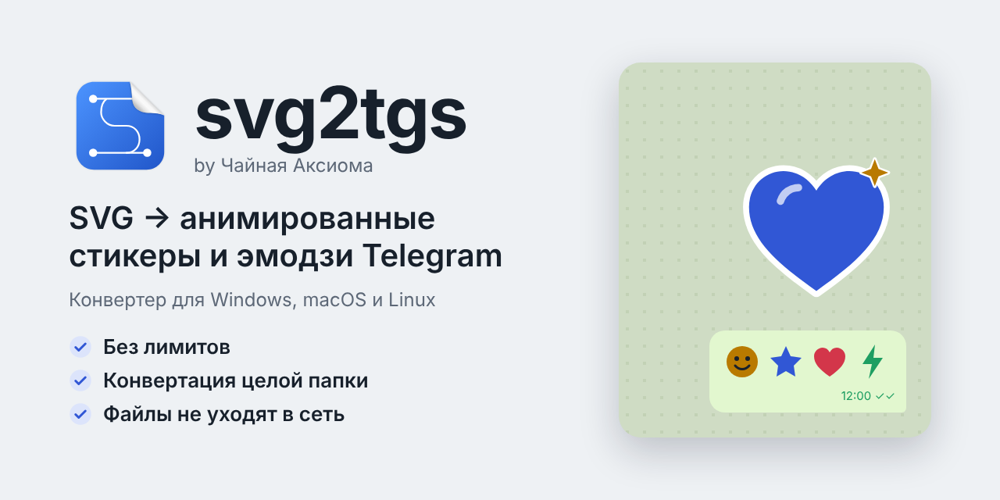

# svg2tgs

Программа для Windows, macOS и Linux: превращает SVG и картинки
(PNG, JPEG, WebP) в стикеры и эмодзи Telegram (формат TGS).

- **Без лимитов** — любое число файлов, бесплатно.
- **Целые папки** — конвертация пачкой, с вложенными папками.
- **Файлы не уходят в сеть** — всё считается на компьютере, программа не
  обращается к интернету, пока вы сами не выгрузите стикеры в Telegram.
- **Превью как в Telegram** — светлый и тёмный чат, отрисовка тем же
  движком, что в Telegram (rlottie).
- **Картинки тоже** — PNG, JPEG и WebP переводятся в контуры: логотипы,
  иконки, рисунки, пиксель-арт; плавные переходы — градиентом.
- **Нарезка на эмодзи** — большой рисунок раскладывается на сетку эмодзи
  без швов.
- **Проверка требований Telegram** — размер файла, холст, длительность.
- **Выгрузка в Telegram** через своего бота — новый набор стикеров или
  эмодзи, дописать в свой набор, поменять порядок, эмодзи и обложку.

## Попробовать в браузере

[**ax1omgg.github.io/svg2tgs**](https://ax1omgg.github.io/svg2tgs/) — та же
программа без установки: файлы обрабатываются прямо в браузере и никуда
не загружаются. Отличия от установленной версии: превью результата рисует
lottie-web (Telegram — rlottie), для текста в SVG один шрифт (Noto Sans),
результат скачивается `.tgs` или `.zip`, выгрузки в Telegram нет.
Подробно — [возможности](docs/SPEC.md), «Веб-версия».

## Скачать

[**Последняя версия**](https://github.com/Ax1oMgg/svg2tgs/releases/latest):

| Система | Файл |
|---|---|
| Windows 10/11 | `…_windows_x64-setup.exe` |
| macOS 10.15+ | `…_macos_universal.dmg` |
| Linux | `…_linux_amd64.deb` или `…_linux_amd64.AppImage` |
| Командная строка | `svg2tgs-cli_…` |

Установщики без цифровой подписи — как пройти предупреждение системы
при первом запуске, см. [установку](docs/INSTALL.md).

## Автор

Парамонов Григорий aka Ax1oMgg, проект «Чайная Аксиома».
Telegram-канал: [@chajnaya_Axioma](https://t.me/chajnaya_Axioma).

## Документация

- [Установка](docs/INSTALL.md)
- [Командная строка](docs/CLI.md)
- [Возможности](docs/SPEC.md)
- [План развития](docs/ROADMAP.md)
- [Сборка из исходников и структура репозитория](docs/BUILD.md)
- [Выпуск версии](docs/RELEASE.md)
- [Переводы](docs/TRANSLATIONS.md)
- [Макет интерфейса](docs/DESIGN.md)
- [Участие в проекте](CONTRIBUTING.md)
- [Безопасность](SECURITY.md)

## Лицензия

[MIT](LICENSE). Сторонние компоненты — [THIRD_PARTY_NOTICES.md](THIRD_PARTY_NOTICES.md).
